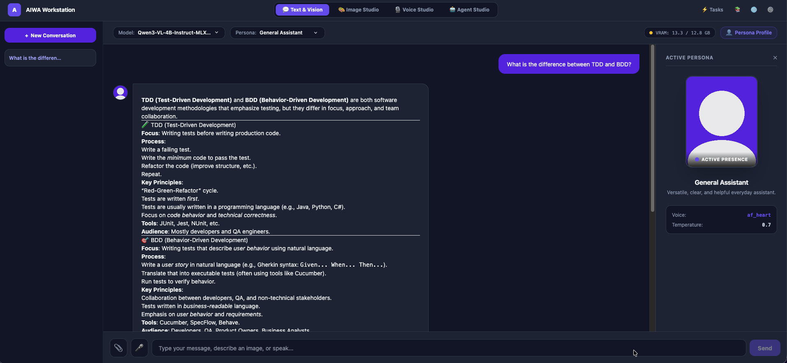
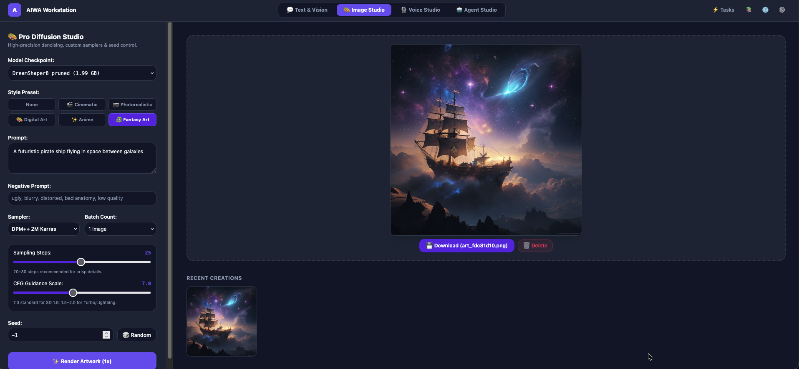
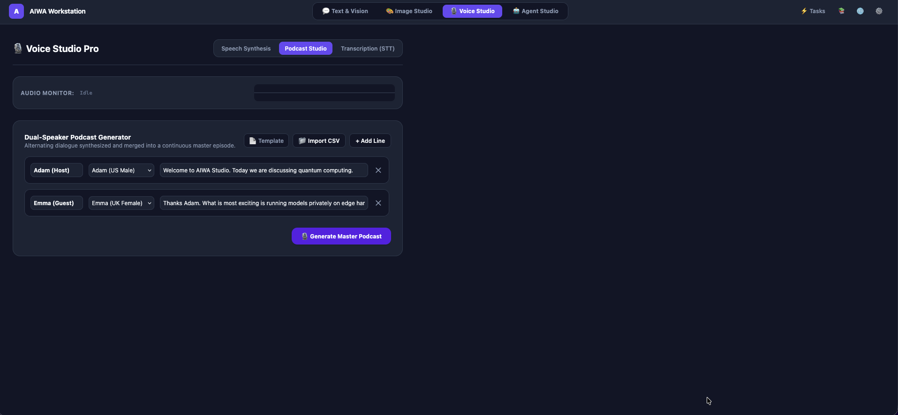
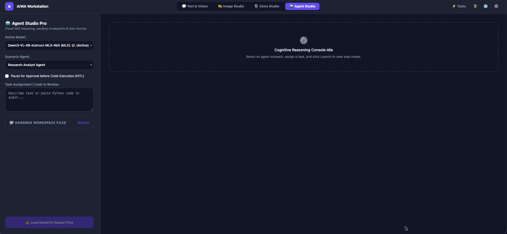

<div align="center">

# 🌿 AI Workspace App (AIWA)
### Local Multimodal AI Workstation

**Say *"Yes"* to 100% private, sovereign, multimodal AI on consumer workstation hardware.**

[](https://www.python.org/)
[](https://fastapi.tiangolo.com/)
[](https://tauri.app/)
[](https://svelte.dev/)
[](https://github.com/ggml-org/llama.cpp)
[](#-universal-hardware--openai-compatibility)
[](https://github.com/astral-sh/uv)
[](#-building-native-desktop-installers-appimage--deb)

[Screenshots](#-application-screenshots) • [Features](#-key-features) • [The Story of "Aiwa"](#-what-does-aiwa-mean) • [Recommended Models](#-recommended-models) • [Quick Start & Install](#-quick-start--installation) • [macOS Guide](#-macos-installation-guide-apple-silicon--intel) • [Architecture](#-architecture) • [Connect & Contribute](#-connect--contribute)

</div>

---

## 📸 Application Screenshots

<table align="center">
  <tr>
    <td align="center" width="50%">
      
      <br />
      <strong>1. Text & Vision Studio</strong>
      <br />
      <sub>Multimodal chat, WhatsApp-style persona avatars, in-bubble Kokoro voice controls, and Light/Dark themes.</sub>
    </td>
    <td align="center" width="50%">
      
      <br />
      <strong>2. Pro Image Studio</strong>
      <br />
      <sub>Direct PyTorch FP16 & C++ <code>stable-diffusion.cpp</code> rendering with samplers, seeds, style presets, and gallery.</sub>
    </td>
  </tr>
  <tr>
    <td align="center" width="50%">
      
      <br />
      <strong>3. Voice Studio Pro</strong>
      <br />
      <sub>Kokoro TTS, CSV multi-speaker podcast generator, Faster-Whisper STT with .SRT export, and live waveform monitor.</sub>
    </td>
    <td align="center" width="50%">
      
      <br />
      <strong>4. Autonomous Agent Studio</strong>
      <br />
      <sub>Visual reasoning DAG, Human-in-the-Loop breakpoints, Python sandbox, GBNF JSON constraints, and saved task records.</sub>
    </td>
  </tr>
</table>

---

## 💡 What Does "Aiwa" Mean?

> **"AI Workspace App (Aiwa)" (أيوه)** is the vibrant, everyday Arabic slang for **"YES!"** — an energetic affirmation of capability and agreement.

When asked:
* *Can you run 7B vision-language models, fast image diffusion, and neural voice synthesis entirely on local hardware?*
* *Can an 8GB to 12GB consumer GPU (or Apple Silicon Mac) handle visual reasoning, text generation, and media without cloud subscriptions or telemetry?*
* *Can developer workflows, document intelligence, and autonomous code execution remain 100% private and offline?*

The answer is **AIWA! (أيوه)**.

---

## 👨‍💻 About the Project & Creator

Hello! I built **AIWA** out of a passion for local-first computing, private AI infrastructure, and responsive developer tooling.

While cloud AI services offer convenient APIs, they lock users into recurring costs, unpredictable latency, privacy compromises, and walled gardens. Most existing local AI interfaces either act as simple text wrappers around Ollama or require managing a disjointed collection of separate applications (one for LLM chat, one for ComfyUI, another for Whisper, and terminal scripts for RAG).

**AIWA** unifies these capabilities into an integrated, decoupled workstation:
* A high-performance **FastAPI daemon** orchestrated by a central **VRAM & Unified Memory Arbiter**.
* A sleek, lightweight **Tauri v2 desktop shell** built with Svelte, TypeScript, and Tailwind CSS featuring clean **Light & Dark** themes.
* **Four dedicated, conflict-free studios** (Text & Vision, Image Diffusion, Voice, and Autonomous Agents) that maximize hardware efficiency without process clashes.

---

## ⚖️ Responsible Use & Ethical Disclaimer

**AIWA** is created to foster local AI sovereignty, privacy-conscious research, and productive developer automation. Because all model inference, diffusion, and code execution run 100% locally on your personal hardware without centralized telemetry or cloud filters, **users bear sole responsibility for the prompts, media, code, and content generated using this platform.**

### Acceptable & Lawful Use Guidelines:
By using this software, you agree to use AIWA exclusively for lawful, ethical, and non-harmful purposes, including agreeing NOT to use AIWA to:
* **Generate Malicious Code**: Create malware, exploits, keyloggers, or automate cyberattacks inside or outside the Python sandbox.
* **Produce Harmful or Non-Consensual Imagery**: Render deceptive deepfakes, non-consensual explicit material, defamatory visuals, or imagery that violates applicable laws.
* **Disinformation & Impersonation**: Generate deceptive voice clones or automated propaganda designed to deceive or harass individuals or organizations.
* **Violate Third-Party Licenses**: Generate or process content in violation of original model licenses (e.g., Qwen, SDXL, or Kokoro community licenses).

### Limitation of Liability:
The creator and contributors of AIWA provide this software on an *"as is"* basis without warranties of any kind. Under no circumstances shall the author be held liable for any damages, legal claims, or misuse arising from local model outputs or user-initiated actions.

---

## 🚀 Key Features

### 1. 💬 Dedicated Text & Vision Studio
* **Dual-Runtime Engine (`llama.cpp` + Native Apple MLX)**: Standardized C++ inference for `.gguf` models across Linux/Windows/macOS (`4,096+` tokens per slot via `--parallel 1`), plus a dedicated **Apple MLX worker (`mlx-lm` / `mlx-vlm`)** for native `.safetensors` acceleration on Apple Silicon Macs.
* **Smart `.safetensors` Header Inspection**: Reads binary tensor headers in under 1ms to accurately distinguish MLX LLMs from Stable Diffusion checkpoints—even when co-located in the same folder—alongside boot-time recursive discovery across `.env`-configured paths.
* **Multimodal Visual Analysis**: Attach `.png`, `.jpg`, or `.pdf` files directly for document extraction (`PyMuPDF4LLM`), UI inspection, and visual reasoning.
* **In-Bubble Voice Controls**: Every individual assistant answer includes an embedded voice selector, **Play/Pause**, and **Stop** button powered by Kokoro TTS.
* **WhatsApp-Style Character Personas**: Switch between specialized personas (*Software Architect*, *Creative Storyteller*, *Code Reviewer*, *Research Analyst*, *Executive Brief Writer*) backed by local disk avatars (`data/avatars/` with automatic `default.png` fallback) and a collapsible right-side presence drawer.
* **In-Chat Editing, Continuation & Export**: Edit (✏️) or delete (✕) any prompt or answer directly, resume long outputs seamlessly with **▶️ Continue**, cancel mid-stream (`⏹ Stop` via `AbortController`), and export any thread to Rich Markdown (`.md`).

### 2. 🎨 Dual-Engine Image Studio
* **Python `diffusers` Engine (Default)**: Serverless PyTorch FP16 pipeline supporting custom schedulers (`DPM++ 2M Karras`, `Euler a`, `Euler`, `DDIM`), CFG scale sliders, up to 50 sampling steps, style presets (*Cinematic*, *Photorealistic*, *Anime*, *Digital Art*), deterministic seeds, and batch sizes (1–4).
* **Pure C++ `stable-diffusion.cpp` Adapter**: Ultra-low VRAM (~1.8–2.5 GB) GGML diffusion binary in `services/diffusion-cpp/` for constrained hardware.
* **Strict Diffusion Path Scoping**: Scans only `DIFFUSION_MODEL_DIRECTORIES` from `.env` across all subdirectories (filtering out MLX LLM `.safetensors`), with instant gallery preview, download, and permanent disk deletion.

### 3. 🎙️ Voice Studio Pro (100% CPU-Bound)
* **Neural Speech Synthesis (Kokoro-82M)**: Full multi-paragraph speech generation with selectable voice profiles (*Heart*, *Adam*, *Emma*) and speed multipliers (`0.75x` to `1.5x`).
* **CSV-Driven Podcast Studio**: Upload multi-line CSV dialogue scripts (`speaker,voice,text`) or build episodes manually to merge multi-speaker interviews with natural silence transitions into a downloadable `.wav` master track.
* **Speech-to-Text & Subtitle Exporter (Faster-Whisper)**: Microphone recording and audio file upload (`.wav`, `.mp3`, `.m4a`, `.webm`) with automatic FFmpeg conversion and one-click **`.SRT`** caption export.
* **Live Audio Waveform Monitor**: Real-time canvas visualizer reacting cleanly to recording and playback states.

### 4. 🤖 Autonomous Agent Studio Pro
* **Visual Reasoning DAG**: Step-by-step cognitive timeline rendering `🎯 Goal` $\rightarrow$ `🧠 Strategy` $\rightarrow$ `⚡ Tool Action` $\rightarrow$ `📦 Sandbox Observation` $\rightarrow$ `📋 Synthesis` alongside an in-studio model switcher.
* **GBNF Grammar Engine**: Official `llama.cpp` GGML BNF logits masking (`grammar_compiler.py`) guaranteeing 100% valid, uncorrupted JSON outputs for tools and structured extraction.
* **Human-in-the-Loop (HITL) Breakpoints**: Pause before sandbox code execution to **Approve**, **Modify Code**, or **Reject** parameters interactively.
* **Persistent Task Records**: Auto-saves agent runs (`agent_runs` table) with inline renaming, instant retrieval, and disk workspace cleanup.
* **Process-Isolated Sandbox**: Enforces CPU execution timeouts and memory limits (`resource.setrlimit`) alongside a conditional workspace file explorer.

### 5. 🌐 Universal Hardware & OpenAI Compatibility
* **Hardware Probe (`hardware_probe.py`) & Unified Memory Arbiter**: Automatically detects NVIDIA CUDA (`pynvml`), Apple Silicon Metal Unified Memory (`sysctl`/`vm_stat`), AMD ROCm, Vulkan, and CPU SIMD (`AVX2`/`AVX-512`), enforcing an 80% memory ceiling.
* **Drop-in `/v1` Compatibility Router**: Standard OpenAI endpoints (`/v1/chat/completions`, `/v1/models`) allowing external IDE tools (Continue.dev, Cursor) and WebUIs to connect directly.
* **HuggingFace Hub Explorer & YAML Gallery**: Search GGUF repositories with `mmproj` vision projector detection and declarative YAML model presets (`data/models/presets/`).
* **Schema Version Tracking & Task Queue**: Records `app_schema_version` (`0.1.0`) in SQLite for safe upgrades and tracks background jobs with human-readable types in `⚡ Tasks`.

---

## 🎯 Recommended Models

| Modality | Recommended Model | Format | Context / Profile | Memory Footprint |
| :--- | :--- | :--- | :--- | :--- |
| **Language & Vision (Linux/Win)** | **`Qwen2.5-VL-7B-Instruct`** | GGUF (`Q4_K_M`) + `mmproj-f16.gguf` | 4,096 tokens (min) | ~4.8 GB VRAM |
| **Language & Vision (macOS)** | **`Qwen3-VL-4B-Instruct-MLX-4bit`** | Apple MLX (`.safetensors` bundle) | Native Metal Unified Memory | ~3.2 GB Unified RAM |
| **Image Generation** | **`SDXL-Turbo`** or **`DreamShaper XL Lightning`** | `.safetensors` (FP16) | 512x512 / 1024x1024, 4–25 steps | ~3.8 – 5.5 GB VRAM |
| **Fast Image Gen** | **`Stable Diffusion 1.5 Pruned`** | `.safetensors` (FP16) | 512x512, 20–25 steps (`DPM++ 2M Karras`) | ~2.2 GB VRAM |
| **Speech Output (TTS)** | **`Kokoro-82M`** | PyTorch / ONNX | Multi-voice (`af_heart`, `am_adam`, `bf_emma`) | CPU (~350 MB RAM) |
| **Speech Input (STT)** | **`Faster-Whisper (base.en / small)`** | CTranslate2 INT8 | Sentence timestamps + SRT | CPU (~250 MB RAM) |
| **Local RAG Embeddings** | **`BAAI/bge-small-en-v1.5`** | FastEmbed ONNX | LanceDB Vector Storage | CPU (~120 MB RAM) |

---

## 🏗️ Architecture

```text
aiwa/
├── apps/
│   └── desktop/               # Tauri v2 Desktop Shell
│       ├── src/               # Svelte + TypeScript + Tailwind CSS Frontend
│       │   ├── components/    # Modular Studios (Chat, Image, Voice, Agent) & Views
│       │   └── lib/           # Stores, API Client, and Types
│       └── src-tauri/         # Rust Desktop Bridge, Folder Sidecar & Capabilities
│
├── backend/                   # Core Python Engine
│   ├── app/
│   │   ├── api/v1/            # REST, SSE & OpenAI Compatibility (/v1) Routers
│   │   ├── core/              # Pydantic .env Config, Ephemeral Security, Logging
│   │   ├── database/          # SQLModel Entities, Seeders & WAL SQLite Engine
│   │   ├── services/          # Chat, MLX Worker, Diffusers, SD.cpp, Audio, RAG & Agents
│   │   ├── supervisors/       # Model Supervisor, Hardware Probe & VRAM Arbiter
│   │   └── utils/             # Safetensors Binary Header Inspector
│   ├── migrations/            # Version-controlled Alembic Migrations
│   └── pyproject.toml         # uv-managed reproducible dependencies
│
├── data/                      # 100% Local Application Data (Git-Ignored)
│   ├── avatars/               # Local disk persona avatars (with default.png fallback)
│   ├── database/              # SQLite DB (WAL Mode + schema version tracking)
│   ├── models/                # Local GGUF, MLX Bundles, Projectors & YAML Presets
│   ├── uploads/               # User attachments & documents
│   ├── generated/             # Rendered artwork, TTS clips & master podcasts
│   └── vector_store/          # Embedded LanceDB tables
│
├── sample/                    # Application Showcase Screenshots
├── services/                  # Standalone External Binaries
│   ├── llama-cpp/             # Compiled llama-server
│   └── diffusion-cpp/         # Compiled stable-diffusion.cpp (sd)
└── Justfile                   # Unified developer task runner
```

---

## 📦 Quick Start & Installation

### Linux Prerequisites (Ubuntu / Debian / Arch / Fedora)
* **GPU**: NVIDIA GPU with 8GB+ VRAM recommended (CUDA 12+ drivers), AMD ROCm, or modern CPU.
* **Tools**: [`uv`](https://github.com/astral-sh/uv), [`just`](https://github.com/casey/just), Node.js 18+, Rust (`cargo`), and `cmake`.
* **System Audio & Build Libraries**:
  ```bash
  # Ubuntu / Debian:
  sudo apt update && sudo apt install -y \
      libsndfile1 ffmpeg build-essential cmake curl git \
      libwebkit2gtk-4.1-dev libxdo-dev libssl-dev libayatana-appindicator3-dev librsvg2-dev
  ```

### 1. Clone the Repository
```bash
git clone https://github.com/atawfiq-it/aiwa.git
cd aiwa
```

### 2. Install Dependencies
Installs backend Python dependencies (including `audio`, `diffusers`, `huggingface-hub`), pre-commit security guards, and Svelte frontend modules:
```bash
just install
```

### 3. Compile Core C++ Runtimes
Compile `llama-server` (and optionally `stable-diffusion.cpp` for ultra-low VRAM image generation):
```bash
just install-llama
# Optional pure C++ diffusion engine:
just install-sd-cpp
```

### 4. Configure Environment (`.env`)
Create a `.env` file in the repository root. Every variable below is actively wired into the application:
```env
# Environment & Networking
ENVIRONMENT=development
API_HOST=127.0.0.1
API_PORT=8000

# Hardware Acceleration ("auto", "cuda", "metal", "rocm", "vulkan", "cpu")
AIWA_HARDWARE_ACCELERATION=auto
MAX_GPU_USAGE_PERCENT=80.0
VRAM_SAFETY_MARGIN_MB=1024

# Model Search Directories (Comma or semicolon separated; scanned recursively on boot)
LLM_MODEL_DIRECTORIES="/path/to/your/gguf_or_mlx/models"
DIFFUSION_MODEL_DIRECTORIES="/path/to/your/safetensors/checkpoints"

# Default Models (Auto-selected on startup & updated when switched in UI)
DEFAULT_LLM_MODEL="Qwen2.5-VL-7B-Instruct"
DEFAULT_DIFFUSION_MODEL="sd_xl_turbo"

# Subprocess Service Ports
LLAMA_SERVER_PORT=8080
COMFYUI_PORT=8188
```

### 5. Launch the Workstation!
Run both the FastAPI daemon and the desktop UI concurrently:
```bash
just workstation
```
Open **`http://localhost:5173`** in your browser (or launch via Tauri).

---

## 🍎 macOS Installation Guide (Apple Silicon & Intel)

AIWA natively supports macOS via **Apple Silicon Metal Unified Memory** (`GGML_METAL=ON`, `mlx-lm` / `mlx-vlm`, and PyTorch MPS) as well as Intel Macs.

### 1. Install Prerequisites via Homebrew
Ensure [Xcode Command Line Tools](https://developer.apple.com/xcode/) and [Homebrew](https://brew.sh/) are installed:
```bash
xcode-select --install
brew install uv just node cmake ffmpeg libsndfile rust
```

### 2. Clone & Install Dependencies
On Apple Silicon (`arm64`), `uv sync` automatically installs `mlx-lm` and `mlx-vlm` alongside core dependencies:
```bash
git clone https://github.com/atawfiq-it/aiwa.git
cd aiwa
just install
```

### 3. Build `llama-server` with Metal Acceleration
CMake automatically detects macOS and compiles `llama-server` with embedded **Apple Metal** shaders (`-DGGML_METAL=ON -DGGML_METAL_EMBED_LIBRARY=ON`):
```bash
just install-llama
```

### 4. Configure `.env` for macOS
Create `.env` in the repository root (works seamlessly with both `.gguf` and `.safetensors` MLX directories):
```env
ENVIRONMENT=development
API_HOST=127.0.0.1
API_PORT=8000

# Automatically queries Apple Unified Memory via sysctl & vm_stat
AIWA_HARDWARE_ACCELERATION=auto
MAX_GPU_USAGE_PERCENT=80.0

LLM_MODEL_DIRECTORIES="/Users/yourname/models/LLM"
DIFFUSION_MODEL_DIRECTORIES="/Users/yourname/models/Checkpoints"
DEFAULT_LLM_MODEL="Qwen3-VL-4B-Instruct-MLX-4bit"
```

### 5. Launch on macOS
```bash
just workstation
```

---

## 🩺 System & Grammar Diagnostics

### Hardware & Environment Check (`just doctor`)
```bash
just doctor
```
Verifies Python, CUDA/Metal availability, Unified Memory / VRAM Arbiter ceiling, `llama-server`, SQLite schema (`v0.1.0`), and configured `.env` paths.

### GBNF Grammar Test (`just test-grammar`)
```bash
just test-grammar
```
Tests constrained JSON logits masking against a live Pydantic schema to verify zero-hallucination structured extraction.

---

## 📦 Building Native Desktop Installers (`.AppImage` & `.deb`)

Package AIWA into standalone Linux desktop bundles with standard OS window frames and an embedded folder-based Python sidecar (`--onedir`):

```bash
just package-desktop
```

Generated bundles are placed in:
* **AppImage**: `apps/desktop/src-tauri/target/release/bundle/appimage/AIWA_0.1.0_amd64.AppImage`
* **Debian Package**: `apps/desktop/src-tauri/target/release/bundle/deb/aiwa_0.1.0_amd64.deb`

---

## 🔒 Security & Data Privacy First

* **Zero External Telemetry**: No prompt, code, document, avatar, or audio snippet ever leaves your machine.
* **Strict Git Shielding**: `.gitignore` and automated pre-commit hooks block any commit containing SQLite databases (`.db`), session tokens, `.env` secrets, uploads, or model files exceeding 10 MB.
* **Local Loopback Security**: FastAPI binds strictly to `127.0.0.1` protected by ephemeral session tokens (`data/.aiwa_session_token`).
* **Subprocess Sandboxing**: Agent Python code runs inside isolated workspaces with strict CPU time caps and memory limits (`resource.setrlimit`).

---

## 🤝 Connect & Contribute

AIWA is actively evolving, and contributions from the developer and AI research community are warmly welcomed!

### Roadmap Progress & Upcoming Milestones:
- [x] HuggingFace GGUF & `mmproj` Model Explorer UI.
- [x] Native Apple Silicon MLX (`mlx-lm` / `mlx-vlm`) runtime & `.safetensors` header classification.
- [x] GBNF Grammar Engine for 100% valid JSON structured outputs.
- [x] `stable-diffusion.cpp` pure C++ diffusion adapter.
- [x] Drop-in `/v1` OpenAI Compatibility Router.
- [x] Native Linux `.AppImage` and `.deb` packaging.
- [ ] AMD ROCm / Vulkan universal builds.
- [ ] Declarative YAML Model Gallery presets.
- [ ] Native Windows packaging (`.exe` via NSIS & `.msi` via WiX).

### Ways to Contribute:
1. **Report Bugs & Suggest Features**: Open an [Issue](https://github.com/atawfiq-it/aiwa/issues).
2. **Submit Pull Requests**: Fork the repository, create your feature branch, and submit a PR!
3. **Model Presets**: Share tested YAML presets under `data/models/presets/` for community GGUF, MLX, and diffusion models.

### Get in Touch:
* **Creator**: Ahmed Tawfiq
* **GitHub**: [@atawfiq-it](https://github.com/atawfiq-it)
* **LinkedIn**: [linkedin.com/in/amtawfiq](https://linkedin.com/in/amtawfiq)
```

---
